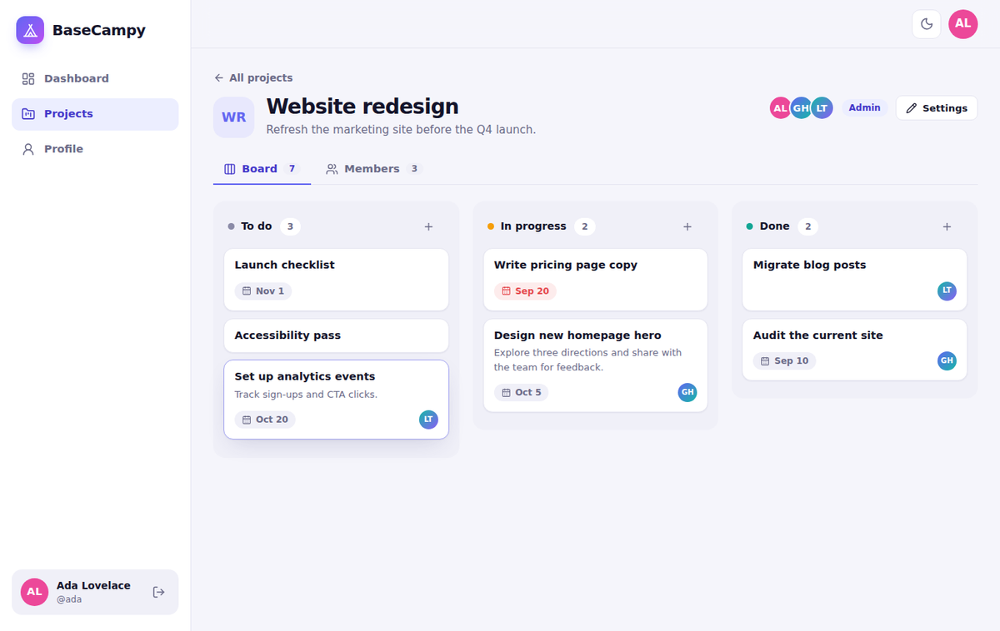
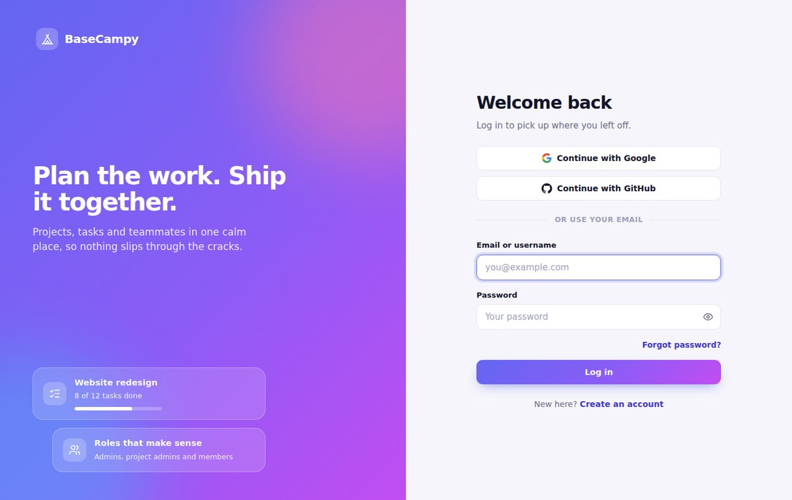
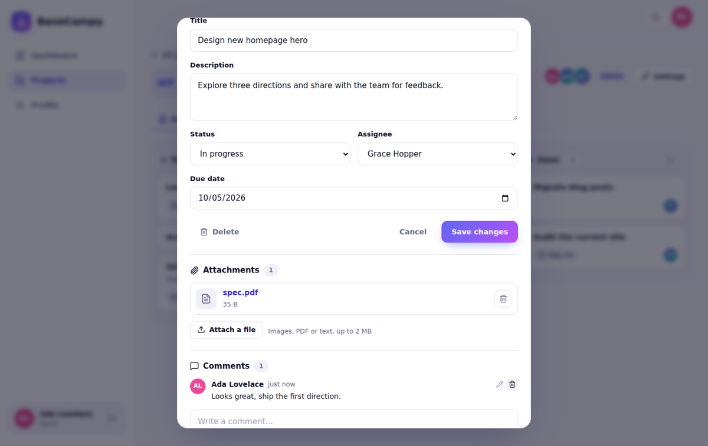
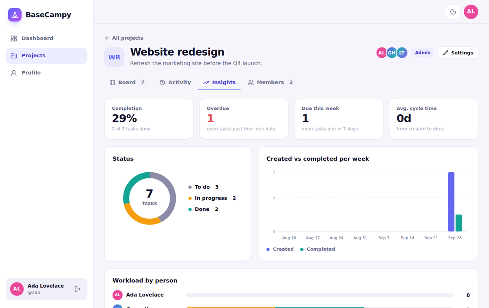
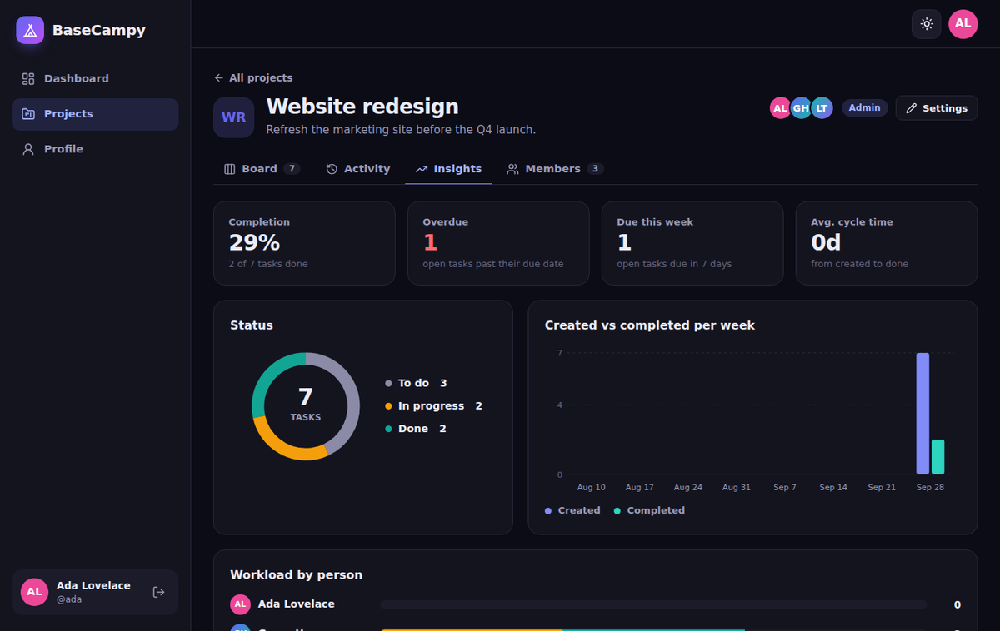

# BaseCampy


A project management app. You make projects, invite people, and move tasks around a board. The API is Node, Express and MongoDB, the frontend is React. You can sign in with email and password, Google or GitHub.



## What's in it

- Sign up and log in with email + password, Google or GitHub. Email verification and password reset work too.
- Projects, with three roles inside each one: admin, project admin and member.
- Invite people by email, even if they don't have an account yet.
- A board with three columns (to do, in progress, done). Drag and drop, assignees, due dates.
- Comments and file attachments on tasks, and an activity feed for each project.
- An insights tab with a few charts: completion, overdue tasks, tasks per person, created vs completed per week.
- Profile photos, a dark theme, and it works on a phone.

## Screenshots

|                                            |                                                       |
| ------------------------------------------ | ----------------------------------------------------- |
|        |                     |
|  |  |

## Stack

- API: Node 24, Express 5, Mongoose
- Frontend: React 19, Vite, plain CSS (no UI library)
- Auth: JWT in httpOnly cookies, bcryptjs, and Google/GitHub login written by hand (no Passport)
- Tests: Vitest and Supertest, run on GitHub Actions
- Hosting: Vercel for the app, MongoDB Atlas for the database

## Running it locally

You need Node 24 (22 works too) and a MongoDB database. A free [Atlas](https://www.mongodb.com/atlas) cluster is fine.

```bash
npm install
npm --prefix client install

cp .env.example .env     # fill in MONGO_URI and the two token secrets

npm run dev              # API on http://localhost:3000
npm run client:dev       # app on http://localhost:5173 (second terminal)
```

Open http://localhost:5173. Vite forwards `/api` to the API, so you don't need any CORS setup.

If `MAILTRAP_SMTP_HOST` is empty, the verification, reset and invite links are printed in the API terminal instead of being emailed. Invite links also show up in the app for the admin.

## Environment variables

| Variable                                      | Needed?          | Notes                                               |
| --------------------------------------------- | ---------------- | --------------------------------------------------- |
| `MONGO_URI`                                   | yes              | MongoDB connection string                           |
| `ACCESS_TOKEN_SECRET`, `REFRESH_TOKEN_SECRET` | yes              | long random strings, different from each other      |
| `ACCESS_TOKEN_EXPIRY`, `REFRESH_TOKEN_EXPIRY` | yes              | `15m` and `7d` work fine                            |
| `FRONTEND_URL`                                | in production    | public URL of the app, used in emails and for OAuth |
| `GOOGLE_CLIENT_ID`, `GOOGLE_CLIENT_SECRET`    | for Google login | leave empty and the button is hidden                |
| `GITHUB_CLIENT_ID`, `GITHUB_CLIENT_SECRET`    | for GitHub login | same                                                |
| `MAILTRAP_SMTP_*`, `MAIL_FROM`                | for real emails  | any SMTP provider works                             |
| `CORS_ORIGIN`                                 | no               | only if the frontend lives on another domain        |
| `PORT`, `NODE_ENV`                            | no               | local only, leave them out on Vercel                |

## Tests

```bash
docker run -d --name basecampy-test-db -p 27017:27017 mongo:7   # any MongoDB works

npm test                   # API tests
npm --prefix client test   # frontend unit tests
```

The API tests use `TEST_MONGO_URI` (default `mongodb://127.0.0.1:27017/basecampy_test`) and wipe that database, so they refuse to run unless the name ends in `_test`. Google and GitHub are replaced with a small fake server (`tests/fake-idp.js`) and emails are captured instead of sent, so you don't need any credentials to run them.

GitHub Actions runs everything on each push and pull request (see `.github/workflows/ci.yml`). Put your own username and repo in the badge URL at the top.

## Google and GitHub login

Both need a one-time registration. The callback URL is `<FRONTEND_URL>/api/v1/auth/oauth/<provider>/callback`, so register one for localhost and one for your deployed URL.

**Google:** in console.cloud.google.com open Google Auth platform, set up the consent screen (External), and add yourself under Audience > Test users while it's in testing. Then Clients > Create client > Web application, add the callback URLs, and copy the client ID and secret.

**GitHub:** Settings > Developer settings > OAuth Apps > New OAuth App. Use your app URL as the homepage and the callback URL from above, then generate a client secret. A GitHub app only takes one callback URL, so make a second app for localhost.

Restart the API after changing `.env`. Vercel preview deployments have their own URLs that aren't registered with Google/GitHub, so login with them only works on localhost and on your production domain.

## Deploying to Vercel

1. Push the repo to GitHub. `.env` is ignored, only `.env.example` is committed.
2. In Atlas, go to Network Access and allow `0.0.0.0/0`. Vercel doesn't have fixed IPs, so use a strong database password.
3. On Vercel: Add New > Project, import the repo, leave the root directory alone. `vercel.json` already has the build command, routing and security headers.
4. Add the environment variables from the table above. Set `FRONTEND_URL` to your Vercel URL. Don't add `NODE_ENV`.
5. Deploy, then open `/api/v1/healthCheck` on your URL. It should say the server is running.

Good to know:

- You need a real SMTP provider for emails in production. Mailtrap's sandbox never delivers to real inboxes.
- Cookies are `Secure` in production, so use the https URL.
- Uploads are stored in MongoDB: avatars up to 512 KB, attachments up to 2 MB (Vercel functions accept at most 4.5 MB per request). If you expect a lot of files, swap `src/utils/storage.js` for Vercel Blob or S3.
- Rate limit counters are in MongoDB as well, because in-memory counters don't work across serverless instances.

## Security notes

Passwords are hashed with bcrypt and never sent back by the API. Tokens live in httpOnly, SameSite=Lax cookies, and refresh tokens are single use. Login and password reset give the same answer whether or not an email exists. OAuth uses PKCE and a signed state cookie, and an existing account is only linked when the provider says the email is verified. There are rate limits per IP, per account and per user, an origin check on state-changing requests, and uploads are checked by their actual contents, not their file names. `vercel.json` sets a strict Content-Security-Policy.

## API

Everything is under `/api/v1` and answers with `{ statusCode, data, message, success }`.

| Area        | Routes                                                                                                                                                                    |
| ----------- | ------------------------------------------------------------------------------------------------------------------------------------------------------------------------- |
| Health      | `GET /healthCheck`                                                                                                                                                        |
| Auth        | `POST /auth/register`, `login`, `logout`, `refresh-token`, `forgot-password`, `reset-password/:token`, `change-password`; `GET /auth/current-user`, `verify-email/:token` |
| OAuth       | `GET /auth/oauth/providers`, `/auth/oauth/:provider`, `/auth/oauth/:provider/callback`                                                                                    |
| Projects    | `GET/POST /projects`, `GET/PATCH/DELETE /projects/:projectId`                                                                                                             |
| Members     | `GET/POST /projects/:projectId/members`, `PATCH/DELETE .../members/:userId`                                                                                               |
| Invitations | `GET/POST /projects/:projectId/invitations`, `DELETE .../:id`, `POST .../:id/resend`; `GET /invitations/:token`, `POST /invitations/:token/accept`                        |
| Tasks       | `GET/POST /projects/:projectId/tasks`, `PATCH/DELETE .../:taskId`, `GET /tasks/mine`                                                                                      |
| Comments    | `GET/POST .../tasks/:taskId/comments`, `PATCH/DELETE .../comments/:commentId`                                                                                             |
| Files       | `POST .../tasks/:taskId/attachments`, `DELETE .../attachments/:fileId`, `PUT/DELETE /users/me/avatar`, `GET /files/:fileId`                                               |
| Insights    | `GET /projects/:projectId/activity`, `GET /projects/:projectId/analytics`                                                                                                 |

### Roles

| Action                                      | Admin | Project admin |           Member            |
| ------------------------------------------- | :---: | :-----------: | :-------------------------: |
| View the project, board, activity, insights |  yes  |      yes      |             yes             |
| Comment and attach files                    |  yes  |      yes      |             yes             |
| Create, edit, delete, assign tasks          |  yes  |      yes      |             no              |
| Move a task between columns                 |  yes  |      yes      | only tasks assigned to them |
| Delete other people's comments and files    |  yes  |      yes      |             no              |
| Invite or remove members, change roles      |  yes  |      no       |             no              |
| Edit or delete the project                  |  yes  |      no       |             no              |

Whoever creates a project is its admin, and a project can't be left without one.

## Folders

```
api/index.js          Vercel entry point, just re-exports the Express app
src/                  the API (routes, controllers, models, middleware, utils)
client/               the React app
tests/                API tests and the fake Google/GitHub server
.github/workflows/    CI
docs/screenshots/     images used in this README
vercel.json           build, routing and security headers
```
